<div align="center">
  <picture>
    <source media="(prefers-color-scheme: dark)" srcset="assets/terminal-dark.svg">
    
  </picture>
</div>

Hi, I'm Mark. Fresh grad from the Philippines. I write Laravel and JavaScript, and I'm looking for my first full-time remote job.

I'm new, so I'll skip the big claims. I read the docs and I ask before I guess.

**[Poke at the live terminal →](https://markmingala.dev/#terminal)** (that one takes typing). The ones below are just for show.

<details>
<summary><code>$ cat stack.txt</code></summary>

```console
$ cat stack.txt
laravel, php, mysql       what I reach for first
javascript, typescript    ionic and electron when it's an app
git                       every day
docker, github actions    learning these. not claiming them yet
```

</details>

<details>
<summary><code>$ ls projects/</code></summary>

```console
$ ls projects/
nexus/       laravel. getting it deployed for real
helpdesk/    laravel + livewire. tickets and SLA timers. next up

$ cat README
no live links yet. the first one lands here when it's up.
my older repos are private for now.
```

</details>

<details>
<summary><code>$ mail mark</code></summary>

```console
$ mail mark
mingalamark26@gmail.com
```

[Email me](mailto:mingalamark26@gmail.com) · [markmingala.dev](https://markmingala.dev)

</details>

<details>
<summary><code>$ sudo hire me</code></summary>

```console
$ sudo hire me
ok.
mingalamark26@gmail.com
```

</details>
